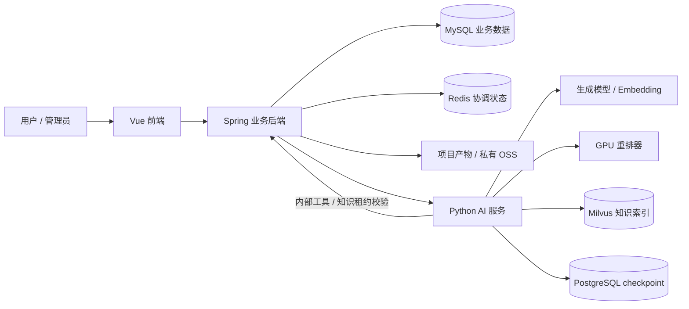
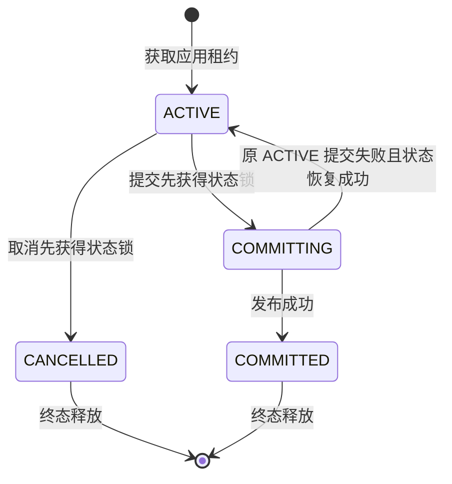

# AI 应用生成平台：2027 届秋招项目学习与面试手册

适用方向：Java 后端、AI 应用 / Agent 开发。核对日期：2026-10-14。

本手册用于理解项目、准备演示和回答面试追问。实现说明以当前源码为依据；历史评测结果单独注明出处，不代表本次重新执行了真实模型或端到端测试。简历中的“我负责”需要与你实际参与的工作一致，本文不能替你确认个人贡献。

## 阅读路线

| 阶段 | 读什么 | 学完应能做到 |
|---|---|---|
| 第一遍：建立整体认识 | 第 1～3 节 | 不看稿讲清用户需求、服务分工和两条主链路 |
| 第二遍：解释简历 | 第 4～8 节 | 每项经历讲清问题、方案、取舍和失败边界 |
| 第三遍：准备追问 | 第 9～11 节 | 解释并发时序、RAG 指标和 Java 基础关联 |
| 第四遍：实际操作 | 第 12～14 节 | 跑通自己的演示、定位源码、准备个人贡献证据 |

不要只背类名。每项经历都按“原来有什么问题 → 我改了什么 → 为什么这样做 → 如何验证 → 仍有哪些限制”组织。

## 1. 项目到底解决什么问题

这是一个根据自然语言需求生成、修改和交付网页应用的平台。用户描述页面需求后，系统选择生成类型，调用 AI 生成代码，由后端负责保存、校验、构建，再提供预览、部署和下载。平台还包含用户、权限、聊天历史、社区和管理功能，并提供基于产品知识库的客服问答。

项目里有两条独立的 AI 业务链路：

- **代码生成**：需求输入 → 生成类型路由 → 工作流 / 工具调用 → 校验与有限修复 → 产物发布 → 前端展示与预览。
- **客服 RAG**：管理员维护知识 → ETL 建索引 → 用户提问 → 检索与重排 → 基于证据回答 → 返回来源并由 Spring 复核。

代码生成关注“模型输出能否成为可用产物”；客服关注“回答是否有当前有效知识支撑”。不要把客服说成生成图中的一个节点，也不要说客服依赖生成 checkpoint。

### 1.1 核心技术与选择理由

| 技术 | 项目里的职责 | 面试时的解释 |
|---|---|---|
| Java 21、Spring Boot 3.5.4 | 权限、业务数据、文件操作、构建、对外 API | 业务边界继续使用现有 Java 体系 |
| MyBatis-Flex、MySQL | 用户、应用、聊天、知识文档元数据、ETL outbox 等 | 业务状态持久化及本地事务 |
| Redis、Redisson | 会话、限流及生成租约、状态仲裁、工具幂等 | 多 Spring 实例共享协调状态 |
| FastAPI、LangChain、LangGraph | 内部 AI API、模型适配、代码生成工作流 | Python AI 生态更适合模型与工作流迭代 |
| LangChain4j | Legacy 生成链路 | 迁移期间保留旧实现并允许配置回退 |
| PostgreSQL | LangGraph checkpoint 与状态摘要 | 工作流短期状态持久化，独立于业务 MySQL |
| Milvus | 客服知识向量索引 | 支持语义检索和物理 collection / alias 管理 |
| BGE GPU Cross-Encoder | 客服候选重排 | 对问题与候选正文联合评分，提高候选排序质量 |
| Vue、SSE | 生成对话和进度展示 | 用户能看到生成过程，成功后读取完整历史并刷新预览 |

Redis、PostgreSQL、Milvus承担不同职责。不要笼统地称它们都是“缓存”。

## 2. 服务边界与整体架构



### 2.1 谁拥有数据，谁能执行副作用

Spring 是业务数据和生成项目文件的所有者。应用属于谁、用户能否访问、项目写到哪个目录，都不能交给模型决定。

Python 负责模型调用和编排。生成项目的读写、校验、发布与构建必须调用 Spring 内部工具网关。Python 不连接业务 MySQL，也不直接操作生成项目目录。

客服 ETL 是需要说明的细节：Python 会通过受控下载流程取得知识文件并在临时文件中解析。它也访问 Milvus 和 checkpoint PostgreSQL。因此，“Python 不接触任何文件或数据库”是不准确的；应说“不直接访问业务 MySQL 和生成项目目录”。

### 2.2 为什么拆成 Java 与 Python 两个服务

收益是保留 Java 的业务与权限体系，同时让模型、检索和 LangGraph 在 Python 生态内迭代。统一网关降低业务层与具体 AI 实现的耦合，内部工具把模型决策限制在受控执行边界内。

代价是多了一跳网络调用、跨服务协议维护、超时取消传播和部署依赖。不能说拆分天然提高性能；本项目首先解决的是边界清晰和迁移可控。

## 3. 对照简历：哪些说法需要修正

| 简历经历 | 当前源码对应情况 | 建议表达 |
|---|---|---|
| 统一 AI 接入，三种引擎 | 两个具体引擎 Legacy / LangGraph；`gray` / `auto` 是路由策略 | “支持 Legacy、LangGraph 及灰度路由”，避免说有第三套执行引擎 |
| 三种生成模式、六类流式事件 | 三种模式成立；六类属于 Python 内部事件 | “对接六类内部生成事件并适配既有 SSE 协议”，不要说外部 SSE 原样公开六类事件 |
| 模型仅开放五类文件工具 | 五类文件工具仍成立；当前另开放 `image_search`，共六种模型可调用工具 | “模型开放五类文件工具及图片检索，校验、发布和构建由工作流控制” |
| Bearer、沙箱、幂等和 JSON Schema | 存在内部认证、相对路径校验、Redis 幂等与版本化工具契约 | 说明鉴权、参数校验、路径校验是不同防线，幂等不承诺严格 exactly-once |
| staging + alias，保留两代索引支持回滚 | 全量重建使用 staging 和 alias；默认保留代数为 2，有 grace 与保守清理 | “为经核验的版本回退保留索引”，不要说业务库与 Milvus 原子提交或自动回滚所有失败 |
| checkpoint 默认 TTL 24 小时 | `86400` 秒成立；图状态终态尝试提前清理 | “终态尽力清理，24 小时 TTL 兜底”，不是每个完成请求都保留完整状态 24 小时 |
| 2000 字符、80ms、终态回源 | 前端有独立进度累加器和预览协调器 | 可直接讲实现；2000 按 JS 字符串长度处理，终态会同步提交最后一批进度 |

**建议替换第二条简历中的工具描述：**

> 设计 Python AI 服务与 Spring 工具网关的安全边界，接入 Bearer 鉴权、相对路径沙箱、请求级工具幂等及 JSON Schema 契约校验；Python 不直接访问业务 MySQL 和生成项目目录，模型开放五类文件工具及图片检索，产物校验、发布和构建由工作流控制。

本文只提出表述建议，不修改你的简历。

## 4. 简历第一项：统一 AI 接入与流式协议适配

### 4.1 原问题与方案

如果业务 Service 直接依赖 LangChain4j，接入 Python 后容易出现两套入口、不同错误语义和前端分支。项目用 `AiGenerationGateway` 把类型路由、生成和取消统一起来：

```text
AppController → AppServiceImpl → AiGenerationGateway
                               → DelegatingAiGenerationGateway
                                  ├─ LegacyAiGenerationGateway
                                  │   → AiCodeGeneratorFacade → LangChain4j
                                  └─ LangGraphAiGenerationGateway
                                      → Python FastAPI → LangGraph
```

接口提供 `route`、`generate`、`cancel`；生成返回 `Flux<String>`。`@Primary` 的委派网关根据配置选择具体实现，业务层依赖接口而不直接调用模型。

设计模式可以讲“策略选择 + 适配器”：委派实现选引擎，LangGraph 网关把 HTTP / NDJSON 转为既有流处理链需要的消息。不要为了套模式把普通类都说成工厂。

### 4.2 灰度怎么保证稳定

`legacy` 使用旧链路，`langgraph` 全量使用新链路，`gray` / `auto` 先匹配用户白名单，再按百分比选桶。灰度比例限制在 0～100。

稳定主体优先级是 `userId → appId → requestId`。灰度盐和主体经 SHA-256 计算后映射到 0～99；桶号小于比例时进入 LangGraph。

为什么优先用户 ID？应用创建时可能还没有 appId。如果创建时按用户、生成时按应用分桶，同一流程可能换引擎。固定优先级使正常流程中的路由、生成和取消能选择同一个实现。

限制：每次操作会读取当前配置；运行中修改盐、白名单或比例仍可能改变选择。源码不能证明热变更时自动固定已运行请求的引擎。灰度也不是“失败就自动换模型重试”：生成中途切换可能重复写文件或拼接不同产物，不能随意兜底重放。

### 4.3 为什么外部 SSE、内部 NDJSON

外部接口 `/api/apps/chat/gen/code` 使用 SSE，适合浏览器持续接收服务器消息。内部 `/internal/v1/generations:stream` 使用 NDJSON，每行一个 JSON 事件，便于 Java 按行解析。

两者都基于 HTTP；NDJSON 是数据分帧格式，SSE 还规定 `event`、`data` 等文本字段。网络读取的一块字节不一定是一个完整 JSON；当前 Java 使用 UTF-8 `BufferedReader.readLine()` 按换行组帧。

| Python 内部事件 | 含义 | Java 适配要点 |
|---|---|---|
| `content_delta` | 生成或修复候选内容 | Vue 转为 `ai_response`；静态类型保留最后完整候选 |
| `tool_started` | 工具开始 | Vue 转为 `tool_request` |
| `tool_finished` | 工具完成 | Vue 转为 `tool_executed` |
| `node_status` | 节点状态 / 进度 | 部分状态转展示消息，其他不直接透传 |
| `completed` | 工作流成功终态 | 结束内部流；静态类型交出最后候选 |
| `failed` | 失败或取消终态 | 转换为带稳定错误码的异常 |

内部事件有 requestId、sequence、node、data / error。`EventEmitter` 为单次请求产生递增序号；不要因此声称 Java 已按 sequence 去重或实现跨断线事件重放。

### 4.4 成功到底由什么判定

Java 网关不能把 HTTP 200 或读到 EOF 当生成成功。当前要求收到 `completed`；缺失终态报 `LANGGRAPH_STREAM_INCOMPLETE`，长时间没有完整新事件可报 `LANGGRAPH_STREAM_IDLE_TIMEOUT`。外部 Controller 在成功链路发送 `done`，业务错误发送 `business-error`。

HTML / MULTI_FILE 的 `content_delta` 在该实现中承载完整候选或修复结果，Java保留最后候选，不是把每轮修复源码全部拼接成一个文件。事件名字叫 delta，并不能保证每个分支都是 token 级输出。

Java 使用异步 HTTP 请求和虚拟线程读取响应。虚拟线程适合阻塞 I/O，但不代表无限并发；模型供应商、数据库连接、构建和缓冲区仍有容量限制。也不能仅凭 `Flux` 宣称实现了完整背压体系。

### 4.5 口述参考

> 我把 AI 类型判断、生成和取消抽象成统一网关，业务 Service 不需要感知 Java 旧实现或 Python 新实现。迁移时通过用户白名单和稳定哈希分桶控制流量。Python 输出结构化 NDJSON，Java 适配成原有 SSE 处理链需要的消息，并以 completed 作为内部成功条件，避免把断流误判成完成。这个方案的价值是迁移可控和协议兼容，代价是需要维护跨服务超时、取消和事件契约。

## 5. 简历第二项：工具安全边界与幂等

### 5.1 模型提出动作，可信代码决定能否执行

Vue 分支允许模型选择工具，但模型不能指定 `appId` 和 `codeGenType`。工作流先校验工具白名单与模型参数，再注入可信字段；工具调用带顶层 `appId`、`requestId`、`toolCallId` 和 arguments，经 Bearer 认证到 Spring。

| 模型可调用工具 | 用途 |
|---|---|
| `dir_read` | 读取目录 |
| `file_read` | 读取文件 |
| `file_write` | 写入文件 |
| `file_modify` | 修改文件 |
| `file_delete` | 删除文件 |
| `image_search` | 搜索页面图片素材 |

`artifact_context`、`artifact_validate`、`artifact_publish`、`project_build`、`vue_source_snapshot` 属于契约中的工作流工具，`modelCallable=false`。构建和发布不是模型随意选择的权限。`vue_source_snapshot` 在 Spring 中采用瞬时读取，绕过成功结果缓存以避免源码快照进入 Redis。

### 5.2 四道校验分别防什么

1. **Bearer 鉴权**：拒绝未持有共享密钥的内部调用。它不是终端用户授权，用户权限仍由 Spring 业务入口负责。
2. **工具与参数契约**：版本化 JSON Schema 限制工具请求 / 响应形状，Python 拒绝未知工具、额外模型字段和受控字段。Schema 不能替代文件安全检查。
3. **应用路径沙箱**：Spring根据可信应用与类型得到根目录，拒绝绝对路径，使用 `resolve().normalize()` 后检查 `startsWith(root)`，阻止普通 `../` 越界。
4. **业务规则**：限制危险文件删除；MULTI_FILE 的通用写改删被拒绝，活动版本只能通过发布流程更新。

这里的路径沙箱是应用级路径约束，不是容器或操作系统级隔离。当前通用工具路径检查没有展示完整的真实路径 / 符号链接防护，不能把它说成已解决所有文件系统逃逸风险。如果被追问，可解释后续应检查真实路径、符号链接和检查到使用之间的竞态。

### 5.3 幂等为什么不是只有 toolCallId

作用域是 `appId + requestId + toolCallId`。同一工具调用的重试应复用同一个 ID；新业务操作使用新 ID。

Spring 在 Redis 中保存状态、工具名、请求指纹和成功结果，并用分布式锁协调：

```text
不存在记录 → 写 RUNNING → 执行工具 → 写 SUCCEEDED 与结果
已有 SUCCEEDED + 相同工具/指纹 → 返回缓存结果
已有记录 + 工具或参数不同 → TOOL_IDEMPOTENCY_CONFLICT
已有 RUNNING → TOOL_EXECUTION_INDETERMINATE
```

不是“相同 toolCallId 不看参数直接成功”。请求指纹用于阻止同一作用域内复用 ID 执行另一个动作。幂等结果有 TTL，因此不能声称永久去重。

### 5.4 最容易被追问的失败窗口

假设文件已经写成功，但 Redis 成功结果写回失败。这两个动作没有跨系统事务，服务无法确定重试是否会重复产生副作用。因此保留不确定状态并返回稳定错误，不把它包装成安全的无条件重试。

该机制处理共享状态和正常成功重放，不承诺严格 exactly-once。工具执行抛错后的清理也不等于副作用一定没有发生：某些文件操作可能已部分执行。

**工具幂等与版本发布幂等必须区分：**前者缓存单次工具结果；`VersionedArtifactStore` 的 release、manifest、请求墓碑和活动指针管理产物发布。两者解决的对象不同。

### 5.5 口述参考

> 我的原则是模型只提议工具动作，文件副作用始终由 Spring 执行。Python 和 Spring 之间有 Bearer 认证，模型只能使用白名单工具，应用身份由工作流注入，Spring 再做路径和危险文件校验。为了处理重试，我用应用、请求和工具调用三个 ID 形成作用域，把执行状态及成功结果放入 Redis。但文件系统和 Redis 不是一个事务，文件成功而结果写回失败时只能报告不确定，不能宣称严格只执行一次。

## 6. 简历第三项：客服 RAG、ETL 与索引发布

### 6.1 为什么需要 RAG

用户问的是平台怎么使用、如何部署或如何管理知识等产品问题。直接让模型回答容易生成与当前产品不符的步骤。RAG 把产品文档作为证据输入，并返回来源，支持知识更新而不需要训练模型。

它不能天然消除幻觉。错误知识、漏召回、上下文裁剪和模型推理错误都可能影响回答，引用合法也不等于回答事实正确。

### 6.2 离线 ETL 链路

```text
管理员上传 / 更新文档
  → Spring 保存私有 OSS 对象与 MySQL 元数据
  → 文档状态与 outbox 任务在同一本地事务写入
  → Worker 领取任务、维护 claim、获取知识变更租约
  → Python 受控下载、文本提取、清洗、切块
  → Embedding 批处理 → Milvus 写入及版本激活
  → Spring 根据结果更新任务和文档状态
```

ETL 即提取、转换、加载。在本项目中对应文件解析、文本规范化与切块、向量生成及索引写入。支持的提取逻辑包括 TXT、Markdown、PDF、DOCX；扫描 PDF 的 OCR 能力不能从文本提取代码直接推断。

为什么用 outbox？如果业务事务提交后直接发 HTTP，请求可能失败；如果先发 HTTP 再提交业务事务，可能出现索引写了而业务回滚。把文档状态和任务记录放入同一个 MySQL 事务，保证业务成功时有待处理任务，由 Worker 执行跨服务动作。

任务大体为 `PENDING → RUNNING → SUCCEEDED`，瞬时失败可重试回 `PENDING`，耗尽进入 `FAILED`。Worker 有 claim 领取 / 刷新、失败分类和退避重试。outbox 提供可恢复处理机制，不是 MySQL 与 Milvus 的分布式原子事务。

索引变更还有 Spring 的知识变更租约和 fence 约束，用于阻止失效任务继续操作索引；不要把它与 Redis 生成租约混为一套机制。

### 6.3 在线问答链路

```text
POST /api/customer-service/ask
  → Spring 登录检查、限流、参数校验
  → Python：问题 Embedding
  → Milvus：Top-8 召回、活动状态与文档版本过滤
  → 无效块过滤、按 chunkId 去重
  → GPU Cross-Encoder 重排
  → 可选分数阈值过滤
  → 按 documentId 选每份文档最高分块，最多 3 份
  → 单块 / 总字符预算 + 最终 JSON UTF-8 字节预算
  → 模型生成回答和引用 ID
  → Python 校验引用 → Spring 复核来源元数据
```

客服当前是无持久化的单轮问答服务，外部返回普通统一 JSON 响应，不是代码生成 SSE，也不使用 LangGraph checkpoint。

### 6.4 Embedding 与 Cross-Encoder 有什么区别

Embedding 把问题和文档分别编码成向量，可预计算文档向量并在 Milvus 中快速搜索，适合大范围召回。Cross-Encoder 把“问题 + 一个候选正文”放在一起联合评分，计算成本更高，适合对少量候选精排。

本项目默认召回 Top-8，最终最多 3 个不同文档上下文。重排不是再次生成向量索引，也不是让大语言模型直接比较所有文档。

默认本地重排模型为 `BAAI/bge-reranker-v2-m3`，设备为 `cuda`；配置支持本地、远程、禁用三种 provider。代码有 GPU 所有权、并发限制和故障处理，但本手册不声称本轮已验证真实 GPU。

### 6.5 当前参数：分清默认值与线上值

| 参数 | 源码默认 / 硬边界 | 为什么需要 |
|---|---|---|
| Embedding 模型 / 维度 | `openai:text-embedding-3-large` / 3072 | 文档和查询必须匹配，模型或维度变更要重建兼容索引 |
| 切块大小 / 重叠 | 1000 / 150 字符 | 平衡语义完整、粒度及跨边界信息，重叠会增加索引成本 |
| 召回 / 最终文档 | Top-8 / 默认 Top-3，最终硬上限 3 | 给精排保留候选，同时限制提示词体积 |
| 单块 / 总上下文 | 最多 1200 / 3000 字符 | 避免知识正文挤占提示预算 |
| 最终提示字节预算 | 默认 16384 字节 | 计入转义后的 JSON UTF-8 体积；不等于精确 token 数 |
| 重排阈值 | 默认 `None` | 可配置，但不能与向量检索分数混用 |
| collection 保留代数 | 默认 2 | 保留当前及历史版本的回退空间 |

`.env` 可覆盖默认配置。未核对运行配置前，应说“源码默认”，不能直接当作真实部署参数。

### 6.6 重排失败怎么处理

未配置重排阈值时，可以回退到原检索顺序并标记运行时降级；显式禁用重排是配置模式，不算运行故障。

配置重排阈值后，如果重排失败，不能拿 Milvus 分数与该阈值比较。系统保守拒答，避免把两个不同评分空间当作同一尺度。

Embedding 或向量库不可用属于服务错误。模型输出解析或引用校验失败返回系统兜底。它们与“知识不足，正确拒答”必须在评测中分开。

### 6.7 来源校验防什么，不能防什么

Python 要求实际回答带非空、无重复、属于最终上下文的 cited chunk ID；重排结果也只能改变分数和顺序，正文与来源元数据回到可信原候选对象。

Spring 再检查 response requestId、文档存在与状态、documentVersion / indexedVersion、文档名称和 chunk 归属等，避免展示无效或过期来源。

这些校验可约束伪造来源和过期元数据，但不能自动证明答案每句话都得到引用支持。还需要人工事实复核或更细粒度证据评测。

### 6.8 staging collection + alias 如何切换

全量重建先写新的物理 collection，旧 alias 继续服务查询。新版本完成文档数量、版本、模型、维度及重建完成记录等校验后，再切换 alias。

```text
重建中：alias → collection_A，collection_B_staging 正在写入
校验成功：alias → collection_B_staging
保留：collection_A 作为经核验的历史版本
```

alias 切换避免查询直接读到半成品。查询先解析当前物理 collection；已经开始的请求仍可能使用旧 collection，因此旧版本清理有 grace window，默认 120 秒，并采用保守的 ownership / protected 状态校验。条件不确定时宁可多保留，不冒险删除。

“保留 2 代”是默认保留策略，不保证任何时刻物理 collection 总数恰好为 2。暂存版本、宽限窗口和不确定状态可能使数量更多。

切换调用异常时会查询 alias 的实际指向，区分明确失败与不确定；某些已切换场景会尝试恢复旧指向。保留旧索引提供运维回退基础，不代表所有故障都自动无损回滚。回退前还要检查旧索引与当前元数据、模型维度是否兼容。

### 6.9 当前值得讲的 RAG 优化

旧逻辑在重排前按文档去重，可能丢掉同一文档中更能回答问题的后续块。当前先保留不同 chunk，让重排选出最相关块，然后再按文档选最高分候选。

例子：文档 D 的块 A 描述功能概览，块 B 描述上传失败处理；问题问上传失败。向量召回先返回 A，若提前按文档去重，B 没机会参加重排。移动去重位置后，B 能竞争最终上下文名额。

这次策略保留 Top-K、上下文预算与安全边界，便于单因素归因。它仍只选每文档一个块；多步骤答案跨同一文档多个块的场景是后续可评估方向，不要说已实现邻块补全。

### 6.10 口述参考

> 客服 RAG 的离线部分由 Spring 管理文档和 outbox 任务，Python 执行解析、切块、Embedding 与 Milvus 索引。在线部分先召回候选，再用 GPU Cross-Encoder 重排，把最多三份文档的受限上下文交给模型，并校验引用。全量重建先写 staging collection，校验完成才切 alias，保留历史版本用于回退。我还关注证据在哪一层丢失，例如把按文档去重移到重排后，让同一文档里更相关的块有机会进入上下文。

## 7. 简历第四项：checkpoint、生成租约与版本发布

### 7.1 checkpoint 保存了什么

项目使用官方 `AsyncPostgresSaver`，生成线程标识为 `{appId}:{requestId}`。图编译时传入 checkpointer，执行期图状态可能包含产物源码。

同一连接池维护 `ai_workflow_status`，只存节点、应用 / 请求 ID、类型、质量结果、修复次数和工具次数等白名单摘要。**“摘要表不存源码”不等于“官方图 checkpoint 从不含源码”。**

默认 TTL 是 86400 秒。摘要更新会刷新 expires_at；请求成功、失败或取消后，会尽力调用 `adelete_thread()` 清理图状态。异常退出时通过 expires_at 找过期 thread，先删图 checkpoint，成功后删摘要；删除失败保留摘要供重试。PostgreSQL 没有在本项目里自动为行实现原生 TTL，过期依靠应用清理。

它是请求内短期状态，不是跨请求知识库，也不是 `PostgresStore` 长期记忆。新请求携带的历史上下文来自 Spring，不是靠沿用旧 thread 自动记住用户。

持久化图状态不等于已经实现进程崩溃后的公开自动续跑接口。面试可说具备执行期 checkpoint 基础，自动恢复需要明确恢复入口、外部工具副作用和幂等约束。

### 7.2 PostgreSQL 故障会不会阻止生成

`checkpoint_enabled` 默认开启，`checkpoint_required` 默认 false。可选模式下启动失败可以降级不使用 saver；required 模式对相应故障采用失败语义。终态清理失败不能反转已经完成的生成结果。

降级后不会仅凭 ping 自动重建整套 saver；恢复依赖服务重启。不要把可选 checkpoint 描述成业务强一致性必需组件。

### 7.3 为什么“有锁”还需要状态门

应用级生成锁拒绝同一应用并发生成，不排队等旧请求结束。状态门负责取消与提交谁先胜出：



`GenerationLeaseService` 用应用生成锁控制并发，再用 transition 分布式锁串行化取消、提交和释放。状态中包含 requestId，旧请求不能操作新请求状态。

| 竞态 | 结果 |
|---|---|
| 取消先把 ACTIVE 改为 CANCELLED | 后续提交拒绝，旧产物不被该请求发布覆盖 |
| 提交先进入 COMMITTING | 取消不再胜出，不能声称用户点停止后一定撤销已开始的发布 |
| 旧请求释放时已有新请求状态 | 只删除匹配旧 requestId 的状态，避免误删 |
| 产物发布成功，COMMITTED 写回失败 | 记录告警，不把已成功发布反向报告成业务失败 |

用户点停止不仅是关掉浏览器连接。Spring 标记取消，通知选中的 AI 引擎，Vue 构建还会进入构建取消逻辑。应用租约在流终止的 `doFinally` 释放，取消链路避免尚未结束的旧工作与新任务重叠。

### 7.4 不可变版本为什么比原地覆盖更合适

HTML / MULTI_FILE 使用 `VersionedArtifactStore`：候选解析、确定性校验成功后，形成不可变 release 与 manifest，再切换活动指针。HTML 还有 Selenium 浏览器烟测。

模型长度截断、解析失败、烟测失败或发布未完成时，保留上一活动版本。界面收到输出不代表产物已经生效；不可变版本和成功终态一起界定可见结果。

这套强发布边界主要对应 HTML / MULTI_FILE。Vue 仍有工具写文件和构建流程，不能把静态类型的 release 保证扩展为所有 Vue 文件操作都能整体回滚。

### 7.5 口述参考

> checkpoint 保存的是单次生成的短期图状态，默认 24 小时过期，正常终态会提前尝试清理。真正决定能否发布的是 Spring 的生成租约和状态门：同一应用只允许一个生成，取消与提交在同一临界区竞争。取消先到就拒绝发布，提交先进入 COMMITTING 就不能再靠取消撤销。静态产物经过校验后发布不可变版本，失败保留上一活动指针，避免迟到请求覆盖当前有效结果。

## 8. 简历第五项：有限流式窗口与终态回源

### 8.1 原来的性能问题

如果每个分片都执行 `reactiveMessage += chunk`，消息越来越长，会持续触发大字符串处理、Vue 更新和内容渲染。输出长度和分片频率同时增长时，界面更容易卡顿。

当前 `generationStreamProgress.ts` 用普通闭包状态保存累计字符数和文本尾部，每批只安排一个刷新任务，快照才进入 Vue 响应式状态。

```text
收到分片 → receivedCharacters += chunk.length
         → visibleContent 仅保留尾部 2000
         → 已有刷新任务就合并，否则安排 80ms 后 flush
成功终态 → finish() 同步提交尾批 → 读取服务端完整聊天记录
失败/停止/卸载 → dispose() 清计时器，禁止迟到回调
```

2000 是 JS 字符串长度，即 UTF-16 code unit 口径，不能说是 2000 token、2000 字节或严格 2000 个完整 Unicode 字符。80ms 是流中合并刷新间隔，成功终态可立即 flush，不是全生命周期绝无间隔小于 80ms 的更新。

### 8.2 为什么必须回源

尾部窗口故意丢弃旧展示内容，因此不能当最终消息保存。成功后重新读取 Spring 完整聊天记录，用服务端结果替换临时进度显示。

该优化只限制生成过程的展示窗口，不意味着完整历史永远不会进入前端，也不能仅凭实现给出“内存下降 90%”等未经测试的数字。窗口存储量约为 O(W)，W 固定为 2000，刷新成本更可控；累计数仍记录整个流的长度。

### 8.3 为什么预览需要单独协调器

`previewRefreshCoordinator.ts` 用 requestKey 和轮次 generation 绑定当前请求。`begin` 只登记资格，保留原 iframe；`complete` 只允许当前轮次第一次成功消费资格，微任务执行前再检查是否已开始新轮次或销毁。

`fail` 和 `dispose` 撤销资格，因此失败、停止、重复成功、旧请求迟到回调都不应触发新的预览刷新。后端控制哪个版本有效，前端控制哪一轮可以刷新界面，两者职责互补。

### 8.4 口述参考

> 我把生成进度从 Vue 响应式消息里拆出来，在普通累加器中只保留最近 2000 字符和总字符数，每 80ms 合并提交一次快照。完成时同步提交尾批，再读取服务端完整聊天记录。预览刷新单独按请求轮次协调，只在当前成功终态执行一次，失败、取消和迟到回调撤销资格。这样控制了流中展示成本，同时保证最终消息完整。

## 9. RAG 指标与可用证据

### 9.1 先分层，后谈提升

| 层次 | 指标 / 检查 | 能说明什么 |
|---|---|---|
| 原始召回 | Recall@8 | 目标证据是否被检索到 |
| 候选排序 | MRR@3、NDCG@3 | 正确候选是否排得靠前 |
| 上下文 | 阈值、文档选择、字符 / 字节裁剪损失 | 召回到的证据是否真正进入提示词 |
| 回答 | 可回答题回答率、无答案拒答率 | 是否给出回答 / 是否拒答，不能替代事实正确率 |
| 引用 | 来源合法性、严格允许集命中 | 引用是否符合契约和题目标注 |
| 人工验收 | 事实、步骤完整、权限边界 | 答案是否真正可用 |
| 工程 | 平均 / P95 延迟、错误率、降级率 | 响应和可靠性表现 |

Recall@K 为命中目标集合占目标集合的比例；MRR@K 为首个相关结果名次倒数的均值，未命中记 0；NDCG@K 衡量位置折损后的排序质量。必须注明相关性标注、分母、排序阶段和无答案题处理口径，不能只报缩写。

### 9.2 仓库已有历史结果

来源：[客服 RAG 优化面试说明](../docs/rag-optimization-interview-20261014.md)。该文记录固定 90 题中的 81 道可回答题和 9 道无答案 / 安全题，比较去重位置调整前后：

| 指标 | 基线 | 候选 |
|---|---:|---:|
| 可回答题回答率 | 71/81，87.65% | 76/81，93.83% |
| 原始 Recall@8 | 96.30% | 96.30% |
| 重排 MRR@3 | 83.54% | 88.07% |
| 重排 NDCG@3 | 86.18% | 90.18% |
| 安全 / 无答案正确拒答 | 9/9 | 9/9 |
| 严格引用通过 | 41/90 | 39/90 |
| P95 延迟 | 3127ms | 3117ms |

这些是**既有文档记录的历史评测**，本次未重跑或独立核验原始逐题报告。面试采用数字前应亲自确认数据集、运行配置、原始报告和参与范围。

结论只能是“候选排序和回答覆盖改善”。严格引用变差，不能说全部质量达标，也不能把 93.83% 回答率说成答案正确率。不要通过直接扩大 expectedDocumentIds 来美化结果；需要核对额外来源是否合理和答案是否有事实问题。

### 9.3 如何回答‘为什么选这些参数’

可答：“Top-8 和 Top-3 是当前默认起点，分别平衡召回候选与上下文成本。去重优化时保持参数和正文不变，便于归因；参数最优性仍需要固定数据集对照和保留集验证。”

不要说 1000 / 150 切块、Top-8 / Top-3 是行业最佳值。选择取决于文档结构、问题类型、Embedding、重排模型和提示预算。

## 10. 高频追问：Java 后端方向

### Q1：为什么不在 Controller 直接调用模型？

Controller 管输入、权限和响应，Service 管业务，Gateway 隔离具体 AI 实现。否则切引擎、模拟测试和统一错误处理会侵入控制层。可结合本项目 route / generate / cancel 三个接口解释。

### Q2：Redis 锁为什么优于 JVM synchronized？

多个 Spring 实例不共享 JVM 锁。Redisson 能协调实例间同一应用的生成。还要说明锁所有者、异常释放及状态门；分布式锁不是数据库和文件系统的一致性万能保证。

### Q3：Flux 切线程后如何释放锁？

租约记录获取锁时的 ownerThreadId，释放采用对应所有者的异步解锁，避免直接在另一个 Reactor 线程用普通 unlock。读 `GenerationLease` 和 `release`，不要只背“finally 解锁”。

### Q4：为什么提交和取消共用临界区？

如果先检查未取消，再不加协调地发布，检查后取消仍可能发生，属于检查到使用之间的竞态。共用 transition 锁把 ACTIVE→CANCELLED 与 ACTIVE→COMMITTING 排序，定义唯一胜出者。

### Q5：outbox 能保证消息只执行一次吗？

不能。它保证本地业务提交与待处理任务记录一起写入；跨服务重试还依赖 claim、租约、版本检查和幂等。需要按重复执行和不确定结果设计。

### Q6：为什么幂等记录要保存参数指纹？

相同 ID 被复用成不同操作时，直接返回旧结果会掩盖错误。指纹校验把这种情况变成冲突，而成功重试复用结果。

### Q7：数据库事务能覆盖 OSS、Milvus 和文件写入吗？

本地 MySQL 事务只能覆盖本地数据库动作。跨系统通过 outbox、版本校验、受控发布、保留旧版本及错误状态协调；不能说加 `@Transactional` 就实现分布式原子提交。

### Q8：SSE 断线后是否自动续跑？

浏览器连接重连和服务端恢复生成是两回事。当前没有证据表明按 Last-Event-ID 续传生成结果；新连接可能触发新的请求，应结合状态查询、取消和应用租约处理。不能宣称天然无缝续传。

### Q9：同一用户的另一个应用能并行生成吗？

生成互斥范围是 appId，不是全用户互斥。实际容量仍受模型、工具和构建资源限制，不能推断所有请求都可无限并行。

### Q10：如何测试取消竞态？

用可控阻塞动作安排两种顺序：取消先获得状态锁时提交必须拒绝；提交先进入 COMMITTING 时取消不再胜出。再检查旧 requestId 释放不会删除新状态、发布成功后状态记录失败不反转结果。只测“调用了 cancel 方法”不足以证明结果正确。

## 11. 高频追问：AI 应用方向

### Q1：为什么用 LangGraph，不直接串函数？

三种生成分支、构建、质量审核和有限修复存在条件与回环。显式状态图便于定义节点状态、修复预算、取消检查及 checkpoint。工作流仍由可信代码控制边界，不是任由模型决定整个流程。

### Q2：生成工作流具体怎么走？

输入校验 → 上下文准备 → HTML / MULTI_FILE / Vue 分支 → 产物校验；需要时构建 → 质量审核 → 静态产物发布 / Vue 完成。校验、构建或质量失败会进入 repair，再回到产物校验；预算耗尽失败。

默认最多修复 2 次，可配置范围最高为 5；不能把默认 2 说成所有部署不可更改的硬限制。Vue 文件工具循环默认上限 40，范围最高 40，生成与修复共享调用计数；工作流主动工具与模型循环计数的口径要区分。

### Q3：质量审核通过就说明页面一定可用吗？

模型审核只是一个信号。静态产物还需要严格解析和确定性校验，HTML 有浏览器烟测，Vue 要构建。构建成功也不能证明所有按钮、路由和图片都正常，仍需浏览器 / 人工验收。

### Q4：为什么要限制修复和工具次数？

模型可能重复读写、不断失败或过度修改。预算给成本、时间和副作用上界；耗尽应明确失败，不能伪造完成。实际响应还受模型超时与网络故障影响。

### Q5：Prompt Injection 怎么防？

知识正文作为不可信上下文，不赋予工具权限；生成工具使用白名单和可信身份注入，构建 / 发布由工作流控制。提示词只是辅助，真正执行权限在服务端。不能宣称所有注入已彻底消除。

### Q6：Embedding 换模型但维度不变，可以直接复用旧索引吗？

不应直接复用。不同模型的向量空间可能不同，即使维度相同也不兼容。重建要绑定模型版本与维度，查询使用匹配配置，alias 切换前校验。

### Q7：为什么引用必须来自最终上下文？

模型没有看到的块不能作为当前回答的可信来源。先约束 cited IDs，再由 Spring检查业务版本；合法 ID 仍需要事实支持检查。

### Q8：怎么定位误拒答？

沿同一请求检查：原始召回 → 过滤 / chunk 去重 → 重排 → 阈值 → 文档选择 → 字符 / 字节裁剪 → 模型拒答 / 解析 → 引用。只有知道证据在哪层丢失，才能决定调整检索、策略、预算还是模型。当前诊断默认关闭且受请求前缀限制，不把用户正文和密钥写公共日志。

### Q9：为什么不直接放大 Top-K？

可能增加精排耗时和噪声，不一定修复提前丢块。先定位原因，再用单因素实验；本次去重位置问题在召回后，原始 Recall 不变符合预期。

### Q10：checkpoint 和长期记忆的区别？

checkpoint 保存 thread 执行状态，长期记忆是跨请求检索与更新的知识 / 用户信息。本项目生成使用短期 checkpoint，客服检索产品知识；两者都不能被说成已经启用用户长期记忆。

## 12. 项目介绍：按岗位调整重点

### 12.1 约一分钟：通用版本

> 这是一个自然语言生成网页应用的平台，支持 HTML、多文件和 Vue 项目生成，包含预览、部署、下载及产品客服。我重点准备的工作是 Java 与 Python AI 服务之间的接入和可靠性：Java 负责业务权限、数据及项目文件，Python 负责模型和 LangGraph 编排；统一网关兼容旧引擎、新引擎及灰度路由，并把内部 NDJSON 适配到前端 SSE。工具执行由 Spring 控制，通过请求幂等和生成状态仲裁处理重试、取消与发布竞态。客服用 Milvus 检索和 GPU 重排提供有来源的回答，前端则使用有限流式窗口和终态回源控制展示成本。

将“我重点准备的工作”换成真实个人参与范围后再用于面试。

### 12.2 Java 后端约三分钟：推荐顺序

1. 业务目标和用户流程，用 20 秒建立背景。
2. 统一网关隔离两套引擎，解释稳定灰度与协议适配。
3. 重点展开一个并发问题：取消与提交竞争，以及为什么既需要锁又需要状态门。
4. 补充工具幂等的失败窗口、ETL outbox 的本地事务边界。
5. 给出实际验证证据和未完成项，保留追问空间。

### 12.3 AI 应用约三分钟：推荐顺序

1. 说明代码生成与客服是两条链路。
2. 解释 LangGraph 的分支、有限修复、工具白名单与可信执行。
3. 展开客服召回、重排、预算、引用及索引发布。
4. 讲去重优化的原因定位和单因素实验；用历史指标时说明引用指标下降。
5. 以短期 checkpoint、安全与故障降级边界收尾。

### 12.4 最难问题 / 最大收获

可以选择取消发布竞态或 RAG 丢块问题。先讲一个具体失败例子，再讲方案，最后讲验证。不要把所有模块堆进一个答案。

若面试官问“你做了多少”，请列真实负责的模块、修改、测试和决策。使用 AI 辅助开发时，重点说明你如何审查边界、验证结果和修正错误；不要把工具生成内容自动当作自己已理解的设计。

## 13. 本地上手与演示准备

### 13.1 先看已有环境，避免覆盖配置

前端是独立仓库：`D:/VibeForge/yu-ai-code-mother-frontend`。业务后端默认 `http://localhost:8123/api`，Python `http://localhost:8000`，Vue `http://localhost:5173`。

代码生成依赖 MySQL、Redis、模型配置和相关工具；checkpoint 依赖 PostgreSQL，可按配置降级；客服还依赖 OSS、Embedding、Milvus 与重排配置。先按 [AI 服务 README](../ai-service/README.md) 和 [启动说明](ai-service-startup.md) 检查本机环境，不要用示例覆盖已有 `.env`。

内部令牌在两个方向必须匹配。不要在演示、报告或公共仓库中展示真实令牌、签名 URL 和供应商密钥。

```powershell
# 后端根目录，先确认数据库、Redis 和配置可用
.\mvnw.cmd spring-boot:run
```

```powershell
# 另开终端，在 ai-service 目录
uv sync --frozen --python 3.12
uv run uvicorn ai_service.app:create_app --factory --host 0.0.0.0 --port 8000
```

```powershell
# 健康检查
Invoke-RestMethod http://localhost:8000/health/live
Invoke-RestMethod http://localhost:8000/health/ready
```

前端按其仓库 package.json 启动开发服务。客服额外启动与回退细节以 AI 服务 README 为准；源码默认 `customer_service_rag_enabled=false`，功能开关和运行配置要明确。

### 13.2 一次面试演示建议

| 演示 | 看什么 | 要留的证据 |
|---|---|---|
| 生成简单 HTML | 成功终态、可用预览 | requestId、生成类型、活动版本 |
| 修改已有页面 | 新版成功前保留旧预览 | 修改前后功能与内容 |
| 生成中停止 | 后端状态、旧结果不被取消请求发布覆盖 | 状态顺序与错误码 |
| 同应用重复生成 | 并发请求被拒绝 | `GENERATION_IN_PROGRESS` |
| 客服可回答问题 | 答案、文档与定位 | 实际来源能支撑答案 |
| 客服无依据问题 | 正常拒答 | 不与服务错误混淆 |
| 管理知识上传 | outbox 到终态、文档版本 | taskId、documentVersion、状态 |

只在专用测试应用和知识数据上做可能产生写入、构建或索引切换的演示。该表是演示计划，本次未执行这些验收。

### 13.3 验证命令如何使用

Java 源码改动运行相关测试并干净编译；Python 改动运行 compileall、pytest、uv lock；前端流式改动运行对应测试和构建。可参考：

```powershell
# 后端根目录，按本次改动选择测试类
.\mvnw.cmd test "-Dtest=DelegatingAiGenerationGatewayTest,GenerationLeaseServiceTest"
mvn clean -DskipTests compile
```

```powershell
# ai-service 目录
uv run python -m compileall -q src
uv run pytest
uv lock --check
```

```powershell
# 独立前端仓库
node --test --experimental-strip-types tests/optimizePrompt.test.ts tests/generationStreamProgress.test.ts tests/previewRefreshCoordinator.test.ts
npm run type-check
npm run build-only
```

Fake 测试通过不等于真实模型、GPU、Redis、Milvus 和完整 SSE 通过。真实检查要记录命令、环境、结果及外部失败原因。

## 14. 源码阅读地图与复习计划

### 14.1 后端与 Python

以下路径相对后端仓库根目录。按调用链读，比从目录顶部逐个读更有效。

| 主题 | 首先阅读 | 相关证据 |
|---|---|---|
| 统一接口与灰度 | `src/main/java/com/yupi/yuaicodemother/ai/gateway/AiGenerationGateway.java`、`DelegatingAiGenerationGateway.java` | `DelegatingAiGenerationGatewayTest` |
| SSE 与内部流 | `controller/AppController.java`、`ai/gateway/LangGraphAiGenerationGateway.java` | `LangGraphAiGenerationGatewayTest` |
| 业务入口 / 租约 | `service/impl/AppServiceImpl.java`、`ai/gateway/GenerationLeaseService.java` | `GenerationLeaseServiceTest` |
| 工具边界 | `controller/InternalAiToolsController.java`、`ai/gateway/ToolInvocationIdempotencyService.java` | `InternalAiToolContractTest`、`ToolInvocationIdempotencyServiceTest` |
| 发布 | `core/artifact/ArtifactPublicationService.java`、`VersionedArtifactStore.java` | `ArtifactPublicationServiceTest` |
| 工作流 | `ai-service/src/ai_service/orchestration/workflow.py`、`events.py` | `ai-service/tests` 中生成 / 取消契约测试 |
| 工具契约 | `ai-service/src/ai_service/contracts/internal-ai-tools-v1.json`、`models/tool_contract.py` | `test_tool_contract.py` |
| checkpoint | `ai-service/src/ai_service/infrastructure/postgres_checkpoint.py` | `test_postgres_checkpoint.py` |
| 客服业务 | `service/impl/CustomerServiceAnswerServiceImpl.java`、`CustomerServiceKnowledgeServiceImpl.java` | `src/test/java/.../customerservice` |
| ETL 调度 | `worker/CustomerServiceKnowledgeEtlWorker.java` | `CustomerServiceKnowledgeEtlWorkerTest` |
| ETL / 检索 / 索引 | `ai-service/src/ai_service/orchestration/document_etl.py`、`customer_service_rag.py`、`infrastructure/milvus_knowledge.py` | `test_customer_service_rag.py`、`test_milvus_knowledge.py`、`test_knowledge_rebuild.py` |
| 重排 | `ai-service/src/ai_service/models/reranker.py` | `test_reranker.py` |

表中省略前缀的 Java 路径统一接在 `src/main/java/com/yupi/yuaicodemother/` 下；同一格只有文件名的项沿用前一个目录。测试名字是阅读入口，不代表本次已运行。

### 14.2 前端

在独立前端仓库阅读 `src/pages/AppChatView.vue`、`src/api/app.ts`、`src/utils/generationStreamProgress.ts`、`src/utils/previewRefreshCoordinator.ts` 及对应纯函数测试。重点观察请求轮次判断、finish / dispose、聊天历史回源、停止和卸载清理。

### 14.3 七天复习安排

| 天 | 任务 | 自测 |
|---|---|---|
| 1 | 画整体架构、区分两条业务链路 | 60 秒项目介绍 |
| 2 | 读网关、灰度、Controller 与事件适配 | 解释 HTTP 200 / EOF 为什么不等于成功 |
| 3 | 读工具契约、沙箱与幂等 | 画文件成功、Redis 写回失败时序 |
| 4 | 读租约、取消、发布和 checkpoint | 解释取消先到与提交先到的不同结果 |
| 5 | 读 ETL、outbox、Milvus 重建 | 解释 alias、两代保留及跨系统事务限制 |
| 6 | 读 RAG 去重、重排、预算与指标 | 解释回答率提升而引用率下降 |
| 7 | 读前端进度，跑专用演示并模拟追问 | 不看稿答第 10、11 节问题 |

### 14.4 面试前需要你补齐的个人信息

- 真实项目周期、个人负责范围，哪些来自原项目，哪些是你的独立改造。
- 每项经历对应的一次提交 / PR、一次测试、一次设计决策，避免只会讲通用方案。
- 实际部署配置、真实环境验收与可复现问题；当前文档的默认值不能替代这些证据。
- 历史 RAG 评测原始记录和人工复核状态；未核验前不用它宣称整体达标。
- 个人下一步优化方向，例如前端性能量化、符号链接防护或 RAG 多块证据；明确属于计划。

不确定的经历不要补造用户数、QPS、成本节省、准确率或生产规模。当前最有说服力的内容是具体竞态、边界控制、错误窗口和有证据的策略取舍。

## 15. 本次文档的事实与验证边界

本次阅读了后端 AGENTS.md、AI 服务 README、核心网关 / 租约 / 工具源码、Python 工作流 / 配置 / checkpoint / 客服检索 / 索引相关实现、独立前端流式进度实现及已有 RAG 面试材料。

本次交付只新增学习文档，不改业务代码、运行配置、索引或前端文件。未运行真实模型、GPU、Docker、集成或端到端验收；历史数字明确沿用既有记录。

进一步阅读：[AI 服务 README](../ai-service/README.md)、[启动与联调](ai-service-startup.md)、[AI 服务重构设计](ai-service-langchain-langgraph-refactor-design.md)、[RAG 优化面试说明](../docs/rag-optimization-interview-20261014.md)。设计文档中的规划需要再次与源码对照，不能直接当作当前实现。
